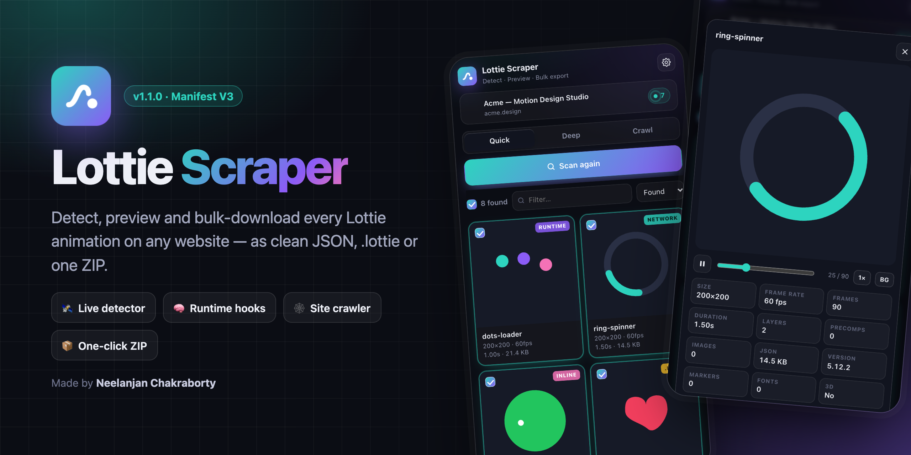
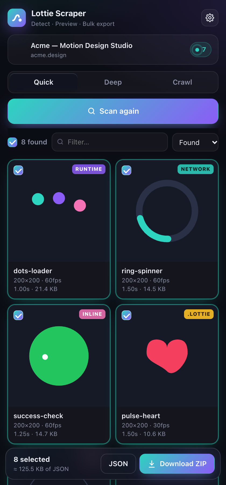
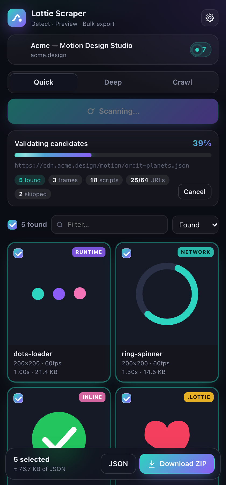
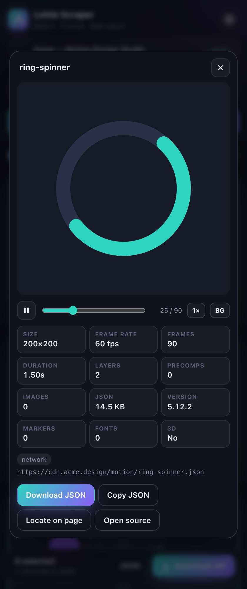
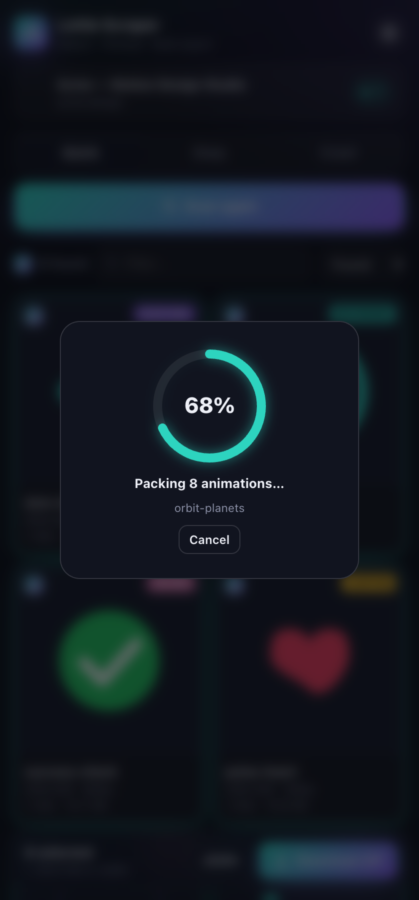
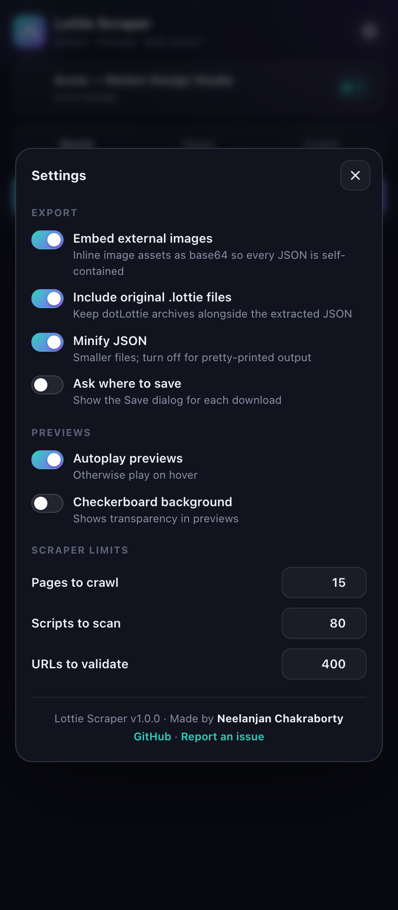
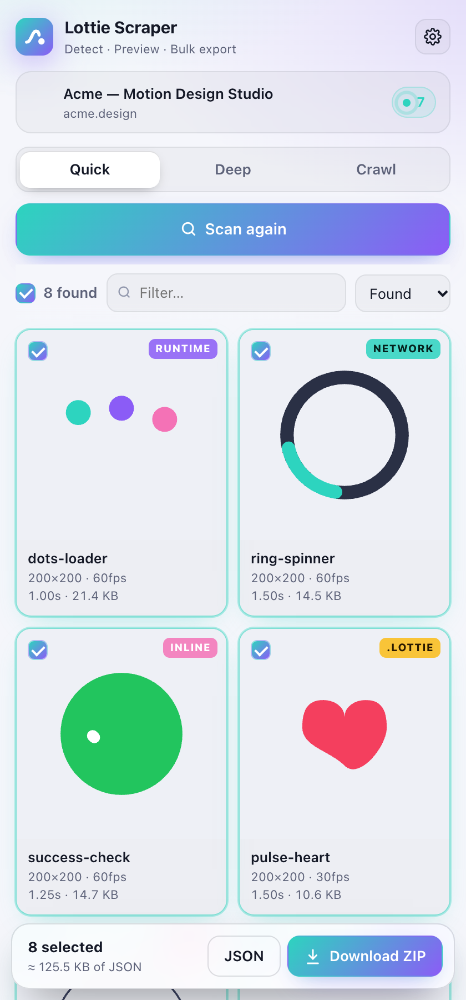
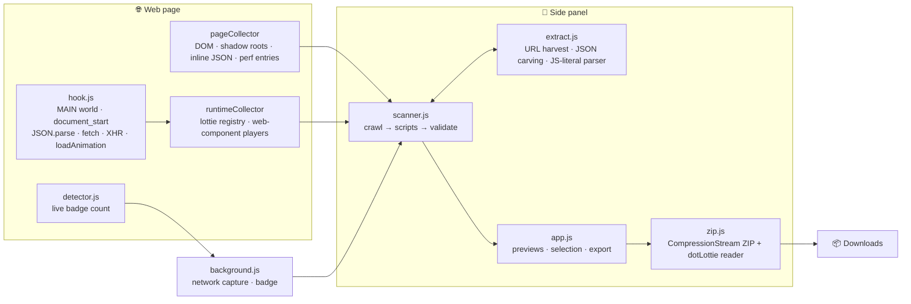

<div align="center">


# Lottie Scraper

**Detect, preview and bulk-download every Lottie animation on any website.**
<br />
As clean JSON, original `.lottie` files, or one ZIP.

<p>
  <a href="https://github.com/Neelanjan-chakraborty/LottieScrapper/releases/latest"></a>
  
  
  
  <a href="LICENSE"></a>
  <a href="https://github.com/Neelanjan-chakraborty/LottieScrapper/stargazers"></a>
</p>

<p>
  <a href="https://github.com/Neelanjan-chakraborty/LottieScrapper/releases/latest/download/lottie-scraper-v1.1.0.zip"></a>
  &nbsp;
  <a href="#-installation"></a>
  &nbsp;
  <a href="https://github.com/Neelanjan-chakraborty/LottieScrapper/issues/new"></a>
</p>



</div>

---

## 📑 Contents

- [Highlights](#-highlights)
- [Screenshots](#-screenshots)
- [Installation](#-installation)
- [Usage](#-usage)
- [How it works](#-how-it-works)
- [Export format](#-export-format)
- [Permissions](#-permissions)
- [Development](#-development)
- [FAQ](#-faq)
- [Author](#-author)

---

## ✨ Highlights

<table>
  <tr>
    <td width="33%" valign="top">
      <h3>🛰 Live detector</h3>
      The toolbar badge counts Lottie animations on each tab while you browse. You don't need to click anything.
    </td>
    <td width="33%" valign="top">
      <h3>🧠 Runtime interception</h3>
      Catches animations as the page loads them through <code>JSON.parse</code>, <code>fetch</code>, <code>XHR</code> or <code>lottie.loadAnimation</code>. It keeps a copy from before the player changes the data.
    </td>
    <td width="33%" valign="top">
      <h3>🔬 Text carving</h3>
      Finds inline JSON, webpack <code>JSON.parse('…')</code> strings, minified JS object literals, double-encoded JSON and escaped URLs.
    </td>
  </tr>
  <tr>
    <td valign="top">
      <h3>🕸 Site crawler</h3>
      Deep mode reads every script bundle and every JSON response. Crawl mode also checks same-origin pages linked from the current page.
    </td>
    <td valign="top">
      <h3>🎞 Live previews</h3>
      Cards play while they're on screen. The detail player has scrubbing, speed control, background options and full metadata.
    </td>
    <td valign="top">
      <h3>📦 One-click ZIP</h3>
      Exports JSON, the original <code>.lottie</code> files and an <code>index.json</code> manifest. Progress is shown and the export can be cancelled.
    </td>
  </tr>
  <tr>
    <td valign="top">
      <h3>🖼 Self-contained output</h3>
      External image assets are embedded as base64. Images inside dotLottie v1 and v2 archives are inlined automatically.
    </td>
    <td valign="top">
      <h3>🎯 Locate on page</h3>
      Scrolls to the element that renders an animation and highlights it.
    </td>
    <td valign="top">
      <h3>🪶 Zero dependencies</h3>
      ZIP files are built with the browser's native <code>CompressionStream</code>. Previews use lottie-web's light build, which doesn't use <code>eval</code>.
    </td>
  </tr>
</table>

---

## 📸 Screenshots

<table>
  <tr>
    <td align="center"><br /><sub><b>Results with live previews</b></sub></td>
    <td align="center"><br /><sub><b>Scan progress</b></sub></td>
    <td align="center"><br /><sub><b>Detail player and metadata</b></sub></td>
  </tr>
  <tr>
    <td align="center"><br /><sub><b>ZIP export</b></sub></td>
    <td align="center"><br /><sub><b>Settings</b></sub></td>
    <td align="center"><br /><sub><b>Light theme (follows the OS)</b></sub></td>
  </tr>
</table>

---

## 🚀 Installation

### Option A: Download the release (recommended)

1. Download **[`lottie-scraper-v1.1.0.zip`](https://github.com/Neelanjan-chakraborty/LottieScrapper/releases/latest)** from the latest release and unzip it.
2. Open `chrome://extensions` (or `edge://extensions` / `brave://extensions`).
3. Turn on **Developer mode** (top-right).
4. Click **Load unpacked** and select the unzipped folder.
5. Pin **Lottie Scraper** to the toolbar.

### Option B: From source

```bash
git clone https://github.com/Neelanjan-chakraborty/LottieScrapper.git
```

Then load the cloned folder with **Load unpacked**, as in Option A.

> **Requires** Chrome, Edge or Brave **116+**, which have the Side Panel API and the MAIN-world content scripts the extension uses.

---

## 🧭 Usage

1. Open any website and watch the **badge** for detected animations.
2. Click the toolbar icon to open the **side panel**.
3. Pick a scan mode and press **Scan page**.
4. Preview, filter, sort and select results, then click **Download ZIP** (or **JSON** for loose files).

| Mode | What it scans | Use it when |
|---|---|---|
| **Quick** | Players, lottie-web registry, runtime hooks, DOM attributes, inline JSON, network log | Most sites; takes seconds |
| **Deep** | Quick, plus every external script bundle and every JSON response | SPAs, React, Next.js and Framer sites that bundle animations |
| **Crawl** | Deep, plus up to *N* same-origin pages linked from the current page | Harvesting a whole site |

**Shortcuts:** <kbd>S</kbd> / <kbd>Enter</kbd> scans · <kbd>⌘/Ctrl</kbd>+<kbd>A</kbd> selects everything visible · <kbd>⌘/Ctrl</kbd>+click a card toggles its selection.

---

## ⚙️ How it works



| Layer | What it catches |
|---|---|
| **Runtime hook** (`content/hook.js`) | Lottie data passing through `JSON.parse`, `Response.json()` or `XMLHttpRequest`, and `lottie.loadAnimation({ animationData \| path })`. It searches up to two levels inside API responses. |
| **Runtime collector** | `lottie.getRegisteredAnimations()`, `<lottie-player>`, `<dotlottie-player>`, `<dotlottie-wc>` and open shadow roots |
| **DOM collector** | `src`, `data-src`, `data-animation-path`, Webflow `data-animation-type="lottie"`, Elementor `data-settings`, preload links and the `performance` resource timeline |
| **Text carving** (`shared/extract.js`) | `.json` / `.lottie` URLs (also HTML-entity and `\/`-escaped forms), balanced-brace extraction of inline objects, webpack `JSON.parse('…')`, minified literals such as `{v:"5.7",fr:30,…,hd:!0}`, and double-encoded JSON |
| **Network capture** (`background.js`) | Every JSON or `.lottie` response the tab receives, recorded by content type |

**Faithful exports.** Players such as lottie-web rewrite animation data in memory after loading it. They make path tangents absolute, attach precomp layers and add internal flags, so saving that data directly would distort shapes. Lottie Scraper prefers the untouched source: hook captures, or the original file re-fetched from its URL. When only the player's copy exists, `restoreLottie()` reverses those edits exactly, and tests check that the result is byte-for-byte identical to the original.

Every candidate is **fetched and checked**. It must be an object with `layers[]`, `fr`, `ip` and `op`, or a dotLottie archive. Results are **deduplicated by fingerprint**, which keeps the cleanest copy.

---

## 📦 Export format

```
lottie-example.com-20261024-2140.zip
├── json/
│   ├── hero-loader.json
│   ├── success-check.json
│   └── …
├── dotlottie/              # original .lottie files (optional)
│   └── pulse-heart.lottie
└── index.json              # metadata, source URLs, detection method
```

<details>
<summary><b>Sample <code>index.json</code></b></summary>

```json
{
  "scrapedFrom": "https://example.com/",
  "date": "2026-10-24T16:10:00.000Z",
  "tool": "Lottie Scraper",
  "count": 1,
  "animations": [
    {
      "file": "json/hero-loader.json",
      "original": null,
      "name": "hero-loader",
      "width": 200, "height": 200, "fps": 60,
      "frames": 60, "duration": 1, "layers": 3, "version": "5.12.2",
      "source": "https://cdn.example.com/hero-loader.json",
      "detectedBy": ["runtime:JSON.parse", "network"],
      "page": "https://example.com/"
    }
  ]
}
```
</details>

---

## 🔐 Permissions

| Permission | Why it's needed |
|---|---|
| `<all_urls>` host access | Read pages and fetch candidate animation URLs and scripts without CORS errors |
| `scripting` | Inject the collectors when you press **Scan** |
| `webRequest` | Record which JSON and `.lottie` responses a tab received (URLs and headers only, never bodies) |
| `downloads` | Save JSON and ZIP files |
| `sidePanel` · `storage` · `activeTab` | Show the UI, remember your settings, and target the current tab |

All processing happens **locally in your browser**. Lottie Scraper has no servers, analytics or tracking.

---

## 🛠 Development

```text
manifest.json          MV3 manifest
background.js          service worker: side panel, badge, network capture
content/hook.js        runtime interceptor (MAIN world, document_start)
content/detector.js    passive badge detector
shared/extract.js      URL harvesting, JSON carving, validation, metadata
shared/zip.js          ZIP writer/reader on native Compression Streams
sidepanel/             UI (index.html · styles.css · app.js) + scanner.js pipeline
sidepanel/lib/         lottie-web 5.12.2 light build (MV3-CSP safe)
tests/run.mjs          unit tests (extraction + ZIP)
scripts/build.sh       packs dist/lottie-scraper-v<version>.zip
```

Run the tests:

```bash
node tests/run.mjs
```

Build a release zip:

```bash
./scripts/build.sh
```

**Releasing:** bump `version` in `manifest.json`, commit, then push a matching tag such as `v1.0.1`. The [Release workflow](.github/workflows/release.yml) runs the syntax checks and tests, builds the zip and publishes a GitHub release.

---

## ❓ FAQ

<details>
<summary><b>Why doesn't it work on some pages?</b></summary>

Chrome doesn't let extensions run on `chrome://` pages, the Chrome Web Store or some built-in viewers.
</details>

<details>
<summary><b>An animation plays on the site but wasn't found.</b></summary>

Some sites load animations only when you scroll or interact. Scroll through the page, then scan again in **Deep** mode. Animations caught by the runtime hook require the page to have loaded *after* the extension was installed, so reload the tab once.
</details>

<details>
<summary><b>Is it fast with hundreds of animations?</b></summary>

Yes. Previews are built one at a time during idle time, only on-screen cards play, at most 32 players exist at once, and off-screen cards skip rendering (`content-visibility`). Animations are kept as compact JSON strings, not object graphs. In a benchmark of 216 animations (27 layers each at 1100×1100), scrolling runs at a steady 60 fps with zero long tasks; v1.0.0 averaged 3 fps on the same test.
</details>

<details>
<summary><b>Why does a preview look static?</b></summary>

Previews use lottie-web's light renderer, which has no After Effects expression support because extensions can't use <code>eval</code>. The **exported JSON is untouched** and plays normally in any full Lottie player.
</details>

<details>
<summary><b>Can I use the animations I download?</b></summary>

Lottie Scraper is a tool for inspection, archiving and working with your own or properly licensed assets. Respect each animation's license and the site's terms.
</details>

---

## 👤 Author

<table>
  <tr>
    <td>
      <b>Neelanjan Chakraborty</b><br />
      Designed and built Lottie Scraper.<br />
      <a href="https://github.com/Neelanjan-chakraborty">@Neelanjan-chakraborty</a>
    </td>
  </tr>
</table>

If Lottie Scraper saves you time, please **⭐ star the repo**. It helps others find it.

## 📄 License

[MIT](LICENSE) © 2026 Neelanjan Chakraborty

<div align="center">
<sub>Made with 💜 for motion designers and front-end developers.</sub>
</div>
